# riskyC1-MC

Dual-core RV32E SoC for the GF180MCU tapeout. Two multicycle cores, each with
an instruction cache, share one SRAM and a set of memory-mapped peripherals
through a round-robin bus. Programs load over UART through a hardware
bootloader. Based on [riskyC1](https://github.com/bastian80821/riskyC1), a
5-stage pipelined RV32I core that passes the official riscv-tests suite on a
Spartan-7.

## Contents

Click a section's title to expand it.

- [User guide: running the flow](#user-guide)
  - [Setup](#setup)
  - [Development flow](#development-flow)
  - [Make commands](#make-commands)
  - [Running assembly programs](#running-assembly-programs)
  - [Viewing waveforms](#viewing-waveforms)
  - [Unit testbenches](#unit-testbenches)
  - [CI](#ci)
  - [Vivado](#vivado)
- [Top-Level](#top-level)
- [Core](#core)
  - [Top-level core](#top-level-core)
  - [Instruction format](#instruction-format)
  - [Instructions](#instructions)
  - [ALU](#alu)
  - [Memory reads](#memory-reads)
- [Loading programs](#loading-programs)
  - [MMIO](#mmio)
  - [UART](#uart)
  - [Bootloader](#bootloader)
- [Shared mux bus](#shared-mux-bus)
- [SRAM](#sram)
  - [High-level diagram](#high-level-diagram)
    - [Controller](#controller)
    - [Macro and wrapper](#macro-and-wrapper)
- [Verification](#verification)
- [Things to know](#things-to-know)
- [Files](#files)

---

<a name="user-guide"></a>
<details>
<summary><b>User guide: running the flow</b></summary>

### Setup

Once per machine:

1. Clone the repository:

   ```sh
   git clone git@github.com:tapeout-unsw/tapeout.git
   cd tapeout
   ```

2. Install the tools (toolchain A), using one of:
   - **Nix (Linux or macOS):** `nix develop` gives the exact tool versions CI
     uses, pinned by `flake.lock`. Add a waveform viewer yourself on macOS.
   - **Homebrew (macOS):** `brew install verilator icarus-verilog yosys coreutils bash`,
     plus Surfer for waveforms. Verilator must be 5.036 or newer, and bash 4 or
     newer (macOS ships 3.2; `run_unit.sh` needs the newer one).
   - **Windows:** WSL2 with Ubuntu, then either option above.

3. Create the Python environment for the cocotb tests:

   ```sh
   python3 -m venv .venv
   .venv/bin/pip install -r sim/requirements.txt
   ```

4. Check everything:

   ```sh
   make env
   ```

   It fails on anything `make ci` needs and only warns about the RISC-V
   compiler and Spike. The physical-design team also runs
   `./tools/check_env.sh --pd` to check toolchain B (LibreLane).

### Development flow

1. Start from the latest `main` on a new branch:

   ```sh
   git switch main
   git pull
   git switch -c feat/<short-name>      # or fix/, test/, docs/
   ```

2. Change the RTL in `rtl/<area>/` and its test in `tb/` or
   `sim/cocotb/<block>/`.
3. Run that block's tests while you work:
   `make test-unit BLOCK=<block>` or `make test-cocotb BLOCK=<block>`.
4. If a test fails, record waveforms and look at them in Surfer (see
   [Viewing waveforms](#viewing-waveforms)).
5. Before pushing, run everything CI runs:

   ```sh
   make ci
   ```

6. Commit, push, and open a pull request into `main`:

   ```sh
   git add <files>
   git commit -m "feat: <what changed>"
   git push -u origin feat/<short-name>
   ```

   CI must pass, and a teammate reviews it before it merges.
7. Once a block's tests are real, add it to `UNIT_GATED` or `COCOTB_GATED` in
   the Makefile so CI requires them from then on.

### Make commands

`NREGS` is `16` or `32`; `TEST` is `all` or a test name; `BLOCK` is `all` or a
block name.

```sh
# setup
make help                          # list every target
make env                           # check the toolchain A install

# static checks
make lint                          # verilator -Wall, 16 and 32 registers
make synth                         # generic yosys synthesis, no ABC, no PDK needed
make synth-full                    # synthesis including ABC gate optimization
make check-top                     # elaborate the dual-core soc_top at both RAM plans

# program tests
make test                          # core and SoC tests at NREGS=16
make test-core NREGS=32 TEST=addi  # core tests (one test, 32 registers)
make test-soc TEST=sample          # SoC boot tests over simulated serial
make test-soc-top                  # dual-core soc_top tests, incl. tests/multicore
make test-all                      # core, SoC and soc_top tests at both register counts

# block tests
make test-unit BLOCK=arbiter       # one SystemVerilog unit testbench (BLOCK=all for every one)
make test-unit-gated               # the unit testbenches CI requires (UNIT_GATED)
make test-cocotb BLOCK=sram_mem    # one cocotb folder (SEED=<n> repeats a run, WAVES=1 records)
make test-cocotb-gated             # the cocotb tests CI requires (COCOTB_GATED)

# debug, CI and clean-up
make waves TEST=addi               # one core test with a VCD
make ci                            # everything CI runs; must pass before a pull request
make clean                         # remove build outputs
```

The scripts in `sim/` still work directly; the Makefile only wraps them.

### Running assembly programs

`programs/` assembles the test programs and runs them on the dual-core
`soc_top`. It needs a RISC-V assembler (`riscv32-none-elf-` by default; the
Nix shell has one). Run these inside `programs/`:

```sh
make                                     # build every program
make run PROGRAM=write_regs              # build and run one program
make run PROGRAMS=lock_counter REGS='0:x10=40 1:x10=40'   # check registers after it runs
make run PROGRAMS=mc_uart UART=HELLOWORLDP                # check the UART output
./test_all.sh                            # run every program with its expected results
```

With a different toolchain prefix, add for example
`RISCV_PREFIX=riscv64-unknown-elf-`. See `programs/README.md` for more.

### Viewing waveforms

Core program tests:

```sh
make waves TEST=addi
surfer sim/obj_dir/core_mc_tb_16/addi.vcd
```

cocotb tests: record one test, then open the file. Macro-model runs use Icarus
and write `sram_mem.fst`; behavioural runs use Verilator and write `dump.vcd`.

```sh
WAVES=1 COCOTB_TEST_FILTER=read_latency_is_one_cycle .venv/bin/python -m pytest -q sim/cocotb/sram_mem -k "256 and macro"
surfer sim/obj_dir/cocotb_sram_mem_w256_macro_icarus/sram_mem.fst
```

Filter to one test: without the filter, every test in the file runs in one
simulation and they end up back to back in a single waveform.

### Unit testbenches

Each block in `rtl/bus`, `rtl/cache`, `rtl/mem` and `rtl/periph` has a unit
testbench in `tb/`. Until its checks are written it prints
`no checks written yet` and fails. When a block's checks are real, add the
block to `UNIT_GATED` in the Makefile; from then on `make ci` and CI require
it to pass. cocotb tests live in `sim/cocotb/<block>/` and are gated the same
way through `COCOTB_GATED`.

Lint runs with `-Wall`. Known harmless warnings are waived one by one in
`tools/lint_waivers.vlt`; any new warning fails the build.

### CI

Every push to `main` and every pull request runs `.github/workflows/ci.yml`:
environment check, lint, synthesis check, the `soc_top` elaboration check,
core, SoC and dual-core `soc_top` tests at 16 and 32 registers, the gated unit
testbenches and the gated cocotb tests, inside `nix develop .#ci`. Unfinished
unit testbenches run only when requested with `make test-unit`. CI prints
check summaries and failure diagnostics without uploading log artifacts. The
physical-implementation flow (LibreLane) is not in CI; it runs at milestones
against tagged RTL.

Synthesis runs in a separate job alongside the lint and simulation job. The
default `make synth` skips ABC gate optimization while retaining RTL synthesis,
memory and gate lowering, and netlist checks. `make synth-full` includes ABC.
Both use 16-word RAM for the generic check and limit each
register configuration to two minutes. Override `SYNTH_TIMEOUT` for longer
local investigations. Synthesis prints one result per configuration. Simulation
prints suite totals and captures output temporarily to validate results and show
failure details; it does not save build or per-test logs.
The workflow can also be started manually. Repository rules should require both
the `synthesis` and `toolchain-a` jobs before merging.

### Vivado

Vivado, non-project mode:

```sh
vivado -mode batch -source sim/run_vivado.tcl -tclargs 16
```

For the Vivado GUI, add `rtl/*.sv` as design sources and `tb/core_mc_tb.sv` or
`tb/soc_tb.sv` as simulation top. Pick the test with `-testplusarg HEX=<path>`
in the simulation settings.

</details>

<a name="top-level"></a>
<details>
<summary><b>Top-Level</b></summary>

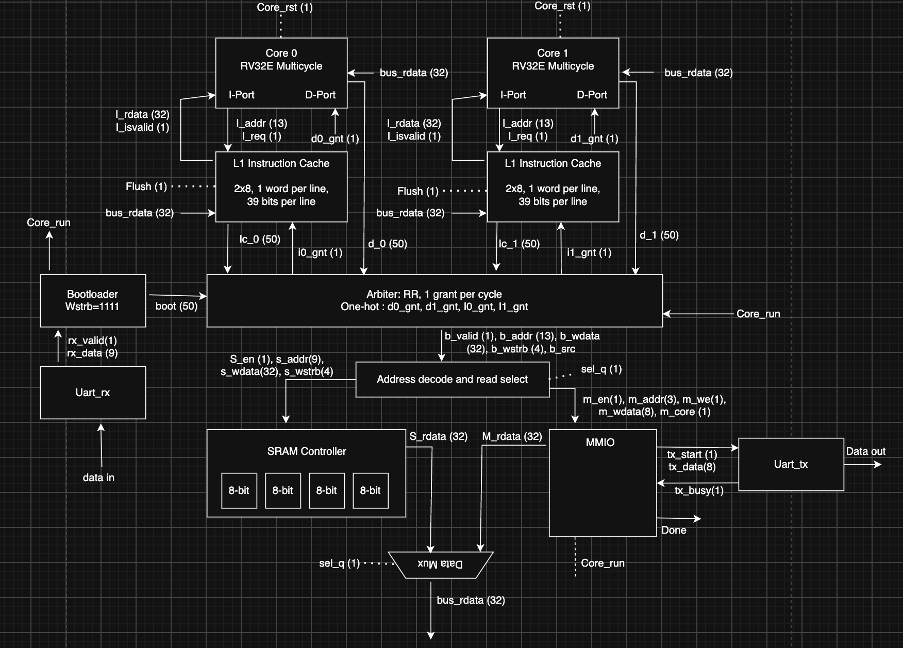

`rtl/soc_top.sv` connects:

| Block | Instances | Role |
|---|---|---|
| Core | `u_core0`, `u_core1` | multicycle RV32E, separate instruction and data ports |
| I-cache | `u_icache0`, `u_icache1` | 2-way, 8 sets, 1 word per line, between each core's instruction port and the bus |
| Bootloader | `u_boot` | receives a program over UART and writes it into SRAM |
| Arbiter | `u_arbiter` | grants one of 5 requesters per cycle, round robin |
| Address decode | `u_decode` | routes the granted access to SRAM or MMIO, selects the read data |
| SRAM | `u_sram` | 4 byte lanes, one GF180 SRAM macro each |
| MMIO | `u_mmio` | UART transmit, lock, core ID, exit |
| UART | `u_uart_rx`, `u_uart_tx` | serial in to the bootloader, serial out from MMIO |

**Parameters**

| Parameter | Default | Meaning |
|---|---|---|
| `NREGS` | 16 | 16 = RV32E, 32 = RV32I |
| `RAW` | 10 | RAM byte address bits: 10 = 1 KiB, 11 = 2 KiB |
| `CLK_FREQ` | 50 MHz | system clock, sets the UART baud divider |
| `BAUD_RATE` | 115200 | UART baud rate |

**Address map** (13-bit bus address, `addr[12]` selects MMIO)

| Address | Name | Read | Write |
|---|---|---|---|
| `0x0000 …` | RAM | 1 KiB or 2 KiB | |
| `0x1000` | UART_DATA | 0 | send the low byte |
| `0x1004` | UART_STATUS | bit 0 = transmitter busy | ignored |
| `0x1008` | LOCK | returns the lock bit, then sets it | clears it |
| `0x100C` | CORE_ID | 0 or 1 | ignored |
| `0x1010` | EXIT | bits 1:0 | sets this core's exit bit |
| `0x1014` | LOCK_PEEK | the lock bit, no side effect | ignored |

The `done` output goes high once both cores have written EXIT.

</details>

<a name="core"></a>
<details>
<summary><b>Core</b></summary>

### Top-level core

`rtl/core/core.sv` is multicycle rather than pipelined. SRAM reads are
synchronous, so read data arrives the cycle after the address; a pipeline
would need a load-use interlock, and the state machine absorbs it in one
extra state instead.

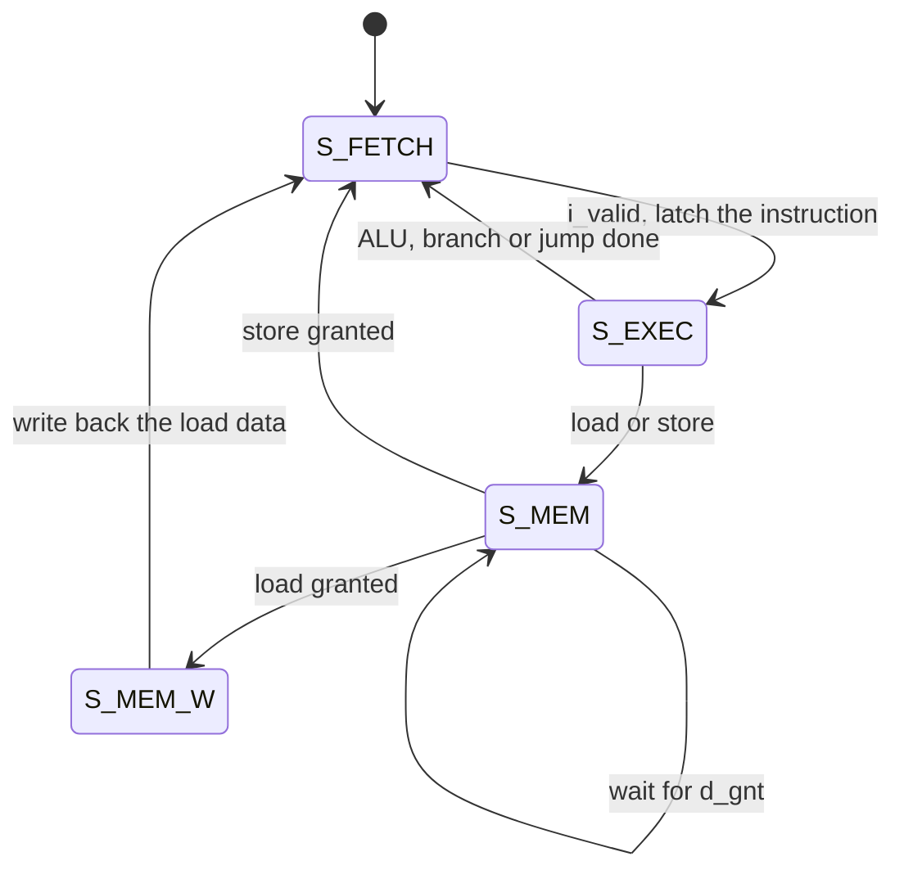

At best (I-cache hit, bus free) that is 2 cycles for ALU, branch and jump
instructions, 3 for stores and 4 for loads. I-cache misses and waiting for the
bus add cycles.

| Port | Signals | Rules |
|---|---|---|
| Instruction | `i_req`, `i_addr[12:0]`, `i_valid`, `i_rdata[31:0]` | `i_req` is high in `S_FETCH`; the instruction is latched when `i_valid` is high |
| Data | `d_req`, `d_addr[12:0]`, `d_wdata[31:0]`, `d_wstrb[3:0]`, `d_gnt`, `d_rdata[31:0]` | `d_req` is high in `S_MEM`. `d_wstrb = 0000` is a load. A store is complete when `d_gnt` is high; load data is on `d_rdata` the next cycle (`S_MEM_W`). |
| Debug | `retire`, `retire_pc` | pulses once per completed instruction |

### Instruction format

RISC-V scatters immediate bits differently for each instruction format, so the
decoder outputs `imm_sel` and `rtl/core/imm_gen.sv` reassembles the immediate.

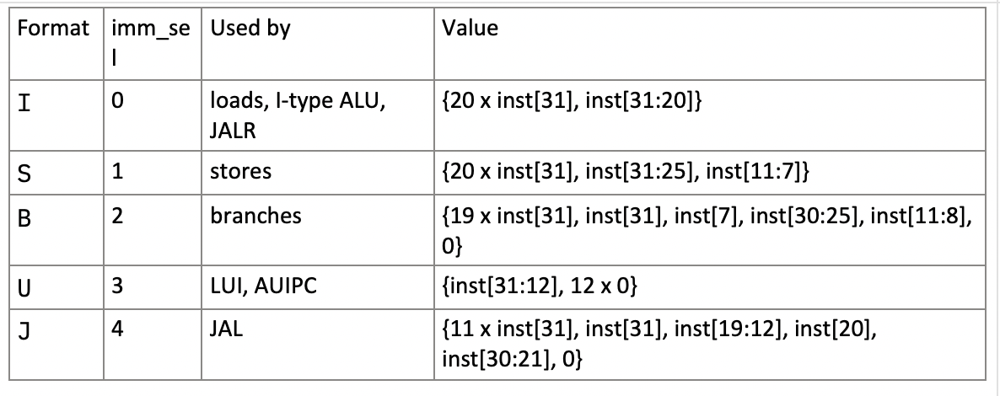

### Instructions

`rtl/core/decoder.sv` turns each instruction into control signals. Any opcode
it doesn't recognise (including `FENCE`) runs as a no-op.

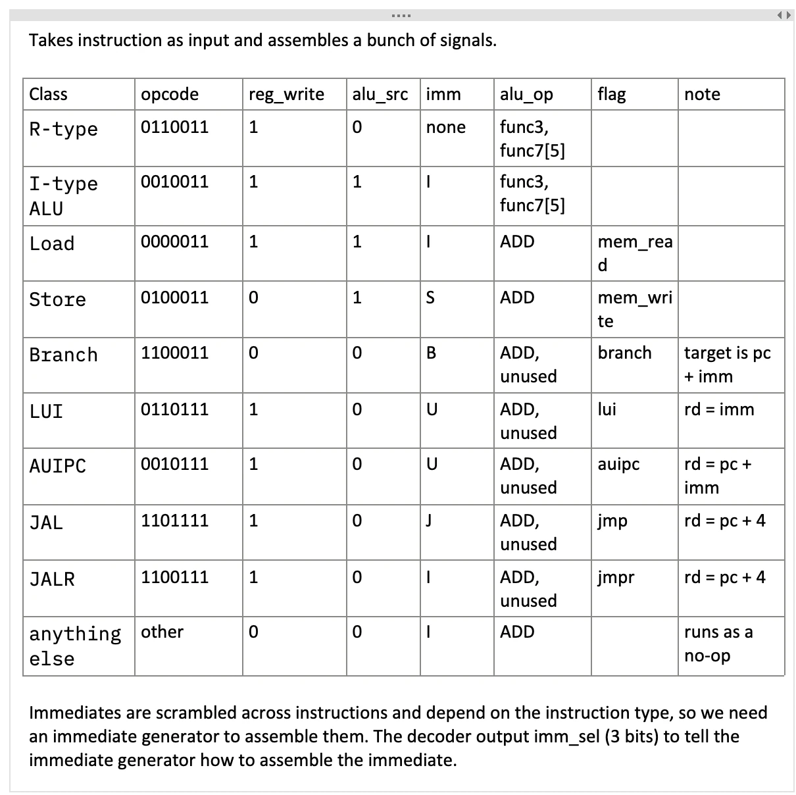

### ALU

`rtl/core/alu.sv` has one adder, one shifter, and gates for AND, OR and XOR.

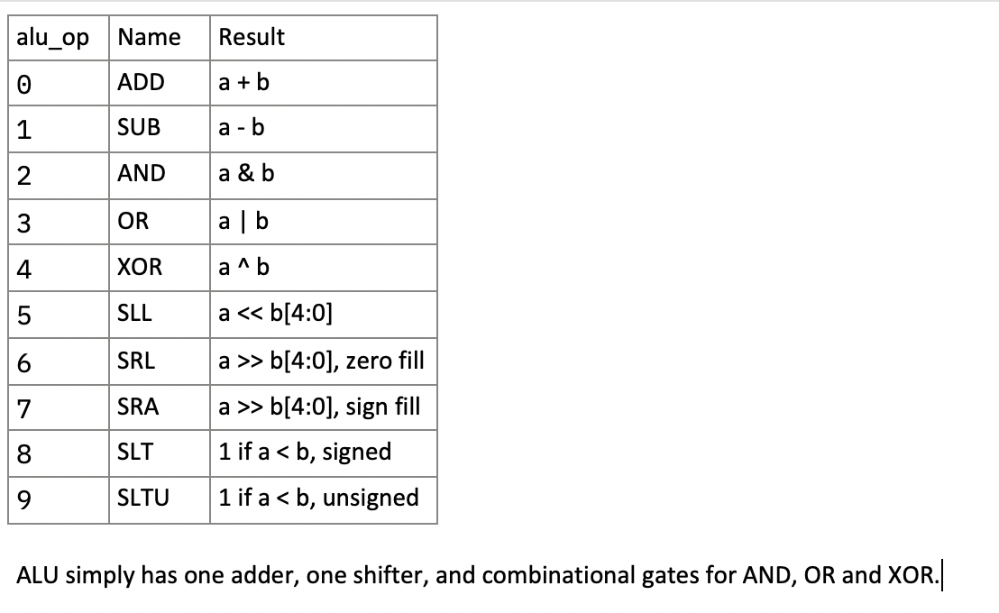

### Memory reads

`rtl/core/mem_access.sv` handles byte and halfword accesses, because memory is
word-addressed.

**Stores:** the data is copied into every byte lane, and `d_wstrb` (built from
`func3` and the low two address bits) picks which lanes are written.

| Instruction | `d_wdata` | `d_wstrb` |
|---|---|---|
| `sb` | the byte copied 4 times | `0001 << addr[1:0]` |
| `sh` | the halfword copied twice | `0011`, or `1100` if `addr[1]` is set |
| `sw` | the word | `1111` |

**Loads:** the full 32-bit word comes back from memory, and a multiplexer
picks the right lane using the low address bits, then sign- or zero-extends
it.

| Instruction | Result |
|---|---|
| `lb` / `lbu` | the selected byte, sign- / zero-extended |
| `lh` / `lhu` | the selected halfword, sign- / zero-extended |
| `lw` | the whole word |

Misaligned accesses aren't supported; the address is rounded down to the word.

</details>

<a name="loading-programs"></a>
<details>
<summary><b>Loading programs</b></summary>

### MMIO

`rtl/periph/mmio.sv` decodes register accesses from `addr_decode` and answers
with one cycle of latency, like the SRAM. It holds the hardware lock and the
two exit bits; both clear while the cores are held in reset (`core_run` low).

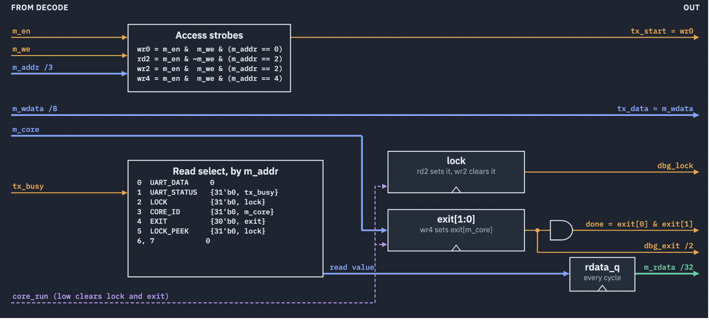

| `m_addr` | Address | Name | Read | Write |
|---|---|---|---|---|
| 0 | `0x1000` | UART_DATA | 0 | `tx_start` pulse, `tx_data = m_wdata` |
| 1 | `0x1004` | UART_STATUS | bit 0 = `tx_busy` | ignored |
| 2 | `0x1008` | LOCK | lock bit, then sets it (test-and-set) | clears the lock |
| 3 | `0x100C` | CORE_ID | which core made the access (`m_core`) | ignored |
| 4 | `0x1010` | EXIT | `exit[1:0]` | `exit[m_core] = 1` |
| 5 | `0x1014` | LOCK_PEEK | lock bit, no side effect | ignored |
| 6, 7 | | unused | 0 | ignored |

`done = exit[0] & exit[1]`.

### UART

`rtl/periph/uart_tx.sv` and `rtl/periph/uart_rx.sv`: 8 data bits, LSB first,
one start bit and one stop bit. One bit time is `CLK_FREQ / BAUD_RATE`
cycles. The receiver passes `rx` through two synchroniser flip-flops, checks
the start bit at half a bit time to reject glitches, then samples each data
bit in the middle.

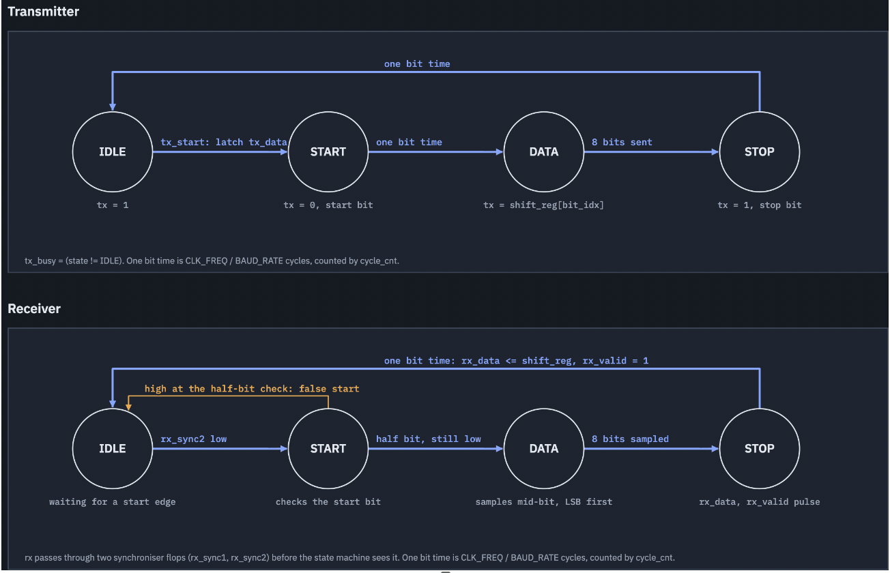

### Bootloader

`rtl/bootloader.sv` turns the serial byte stream into memory writes.

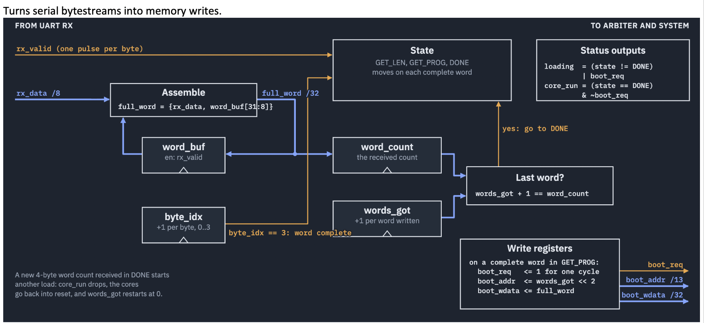

**Protocol** (host to chip, little-endian):
1. 4 bytes: the word count N.
2. N × 4 bytes: the program image, written from address 0, one word per bus
   write.

While loading, `loading = 1` and the arbiter grants only the bootloader. The
cores are held in reset and the I-caches are flushed. When the last word is
written, `core_run` goes high and both cores start from address 0.

The bootloader keeps listening afterwards. A new 4-byte word count drops
`core_run`, resets the cores and starts a fresh load, so test programs can run
back to back without pressing reset.

</details>

<a name="shared-mux-bus"></a>
<details>
<summary><b>Shared mux bus</b></summary>

Five requesters share one bus to memory. `rtl/bus/arbiter.sv` grants one
per cycle, combinationally, and `rtl/bus/addr_decode.sv` routes it.

| `b_src` | Requester |
|---|---|
| 0 | bootloader |
| 1 | core 0 data port (`d0`) |
| 2 | core 1 data port (`d1`) |
| 3 | core 0 I-cache (`ic0`) |
| 4 | core 1 I-cache (`ic1`) |
| 5 | nobody |

**Arbitration:** while `loading` is high, only the bootloader is granted.
Otherwise a 2-bit `rr_pointer` (0 = d0, 1 = d1, 2 = ic0, 3 = ic1) names who is
checked first, and after each grant it moves past the winner
(`rr_pointer <= b_src[1:0]`). Grants are combinational, so a request can be
granted in the cycle it's raised.

**Routing:** `b_addr[12] = 0` goes to SRAM (`s_en`, `s_addr = b_addr[RAW-1:2]`),
`b_addr[12] = 1` goes to MMIO (`m_en`, `m_addr = b_addr[4:2]`). A registered
select, `sel_q`, remembers where each access went, so `bus_rdata` returns the
right target's data in the next cycle.

**Pipelining:** each access takes one cycle on the bus, and its read data
returns the next cycle while the next access is already being granted. In the
example below, core 1's load (core 0 in the RTL) is granted first; core 2's
store (core 1 in the RTL) waits one cycle, then goes into the SRAM while the
SRAM returns core 1's data.

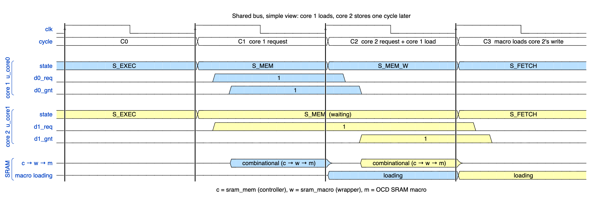

WaveDrom sources, to edit at [wavedrom.com/editor.html](https://wavedrom.com/editor.html):
- [Simple view](docs/diagrams/bus/bus-timing-simple.wavejson)
- [Detailed view, 1 ns per step](docs/diagrams/bus/bus-timing-detailed.wavejson),
  with the delay through the arbiter, controller, wrapper and macro, setup and
  hold windows, and the SRAM read-out path

</details>

<a name="sram"></a>
<details>
<summary><b>SRAM</b></summary>

### High-level diagram

The SRAM is built from four 8-bit lanes, one GF180 SRAM macro per byte of
the 32-bit word. The diagram shows the 2 KiB plan (4 × 512×8); the 1 KiB plan
uses 4 × 256×8.

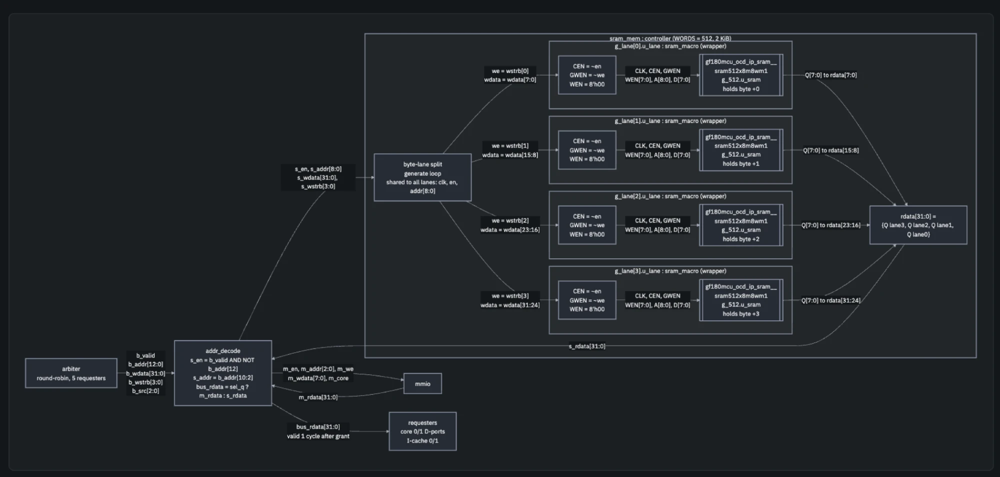

#### Controller

`rtl/mem/sram_mem.sv` presents one word-addressed 32-bit memory to the bus.
Every lane is enabled on every access. Lane `i` writes only if `wstrb[i]` is
set, so lanes not written by a partial store do a read that the bus ignores.
There are no registers in the controller; the macros are the only clocked
elements.

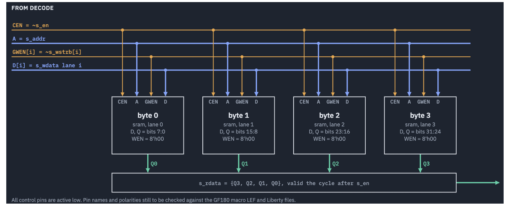

- Reads: `rdata` is valid the cycle after `en`.
- Writes: complete at the clock edge that ends the cycle in which `en` is high.
- One access per cycle, fully pipelined.

#### Macro and wrapper

`rtl/mem/sram_macro.sv` is the only file that knows the vendor cell names and
active-low pins. Everything above it is active high.

| Macro pin | Driven by | Meaning |
|---|---|---|
| `CLK` | `clk` | |
| `CEN` | `~en` | chip enable, active low |
| `GWEN` | `~we` | global write enable, active low (0 = write) |
| `WEN[7:0]` | `8'h00` | per-bit write mask, active low: write all 8 bits |
| `A` | `addr` | row address (8 bits for 256 words, 9 for 512) |
| `D[7:0]` | `wdata` | data in |
| `Q[7:0]` | `rdata` | data out; holds its value during a write |

Build modes:
- **Default:** a behavioural model with the same cycle timing, used by most
  simulations.
- **`+define+USE_SRAM_MACRO`:** instantiates the OCD 3.3 V macro
  `gf180mcu_ocd_ip_sram__sram<WORDS>x8m8wm1` (256, 512 or 1024 words).
  Simulation uses the models in `ip/gf180mcu_ocd_ip_sram/`; synthesis uses the
  `__blackbox.v` files. `VDD`/`VSS` are connected by the physical-design flow.

| Macro | Size | Area |
|---|---|---|
| 256×8 | 301.3 × 224.9 µm | 0.068 mm² |
| 512×8 | | 0.097 mm² |

</details>

---

## Verification

38 official riscv-tests plus an RV32E self-test pass at both 16 and 32
registers. The same programs pass through the SoC, loaded over simulated
serial and checked by decoding the transmit pin.

- `tb/core_mc_tb.sv` preloads memory and watches the memory port. Fast; use it
  while working on the core.
- `tb/soc_tb.sv` only touches the two serial pins, so it exercises the real
  boot path. Slow; use it to check the SoC.
- `tb/soc_top_tb.sv` runs the dual-core `soc_top`, including the multicore
  programs in `tests/multicore/` (lock stress, byte lanes, cache thrash, memory
  walk, UART and back-to-back reloads).
- `sim/cocotb/` holds block-level cocotb tests (SRAM, I-cache) and integration
  tests. The SRAM tests run on both the behavioural model (Verilator) and the
  OCD macro models (Icarus); see `sim/cocotb/sram_mem/README.md`.
- `programs/` builds the assembly test programs; see `programs/README.md`.

## Things to know

`register_file.sv` has a `BYPASS` parameter. It must be 0 here. The bypass is
only correct when `rd_data` comes from a later pipeline stage. In a multicycle
core the write target is the instruction currently reading its operands, so the
bypass closes a combinational loop through the ALU.

With 16 registers, x16 to x31 read as zero and writes to them are dropped. They
are not aliased onto x0 to x15, so RV32I code that uses them fails rather than
appearing to work.

`sram_macro.sv` has a behavioural model by default and instantiates the OCD
3.3 V SRAM macros under `USE_SRAM_MACRO`. The pins and polarities have been
checked in simulation against the OCD models; the LEF and Liberty views come
with the physical-design flow.

The UART baud divider comes from `CLK_FREQ`, which defaults to 50 MHz in
`soc_top` and 100 MHz in the older single-core `soc`.

## Files

```
rtl/soc_top.sv        dual-core top level
rtl/soc.sv            older single-core SoC, used by the core and SoC tests
rtl/bootloader.sv     UART program loader
rtl/core/             core, decoder, imm_gen, alu, register_file, mem_access
rtl/cache/            instruction cache (icache, FSM, storage, LRU)
rtl/bus/              arbiter, addr_decode
rtl/mem/              sram_mem (controller), sram_macro (wrapper)
rtl/periph/           mmio, uart_rx, uart_tx
ip/gf180mcu_ocd_ip_sram/  OCD SRAM simulation and blackbox models
tb/                   unit testbenches and the core, SoC and soc_top testbenches
sim/                  run scripts and cocotb tests
programs/             assembly test programs and their build
tests/                prebuilt test images (tests/multicore for soc_top)
tools/                environment check, lint waivers, RV32E self-test generator
docs/                 diagrams (sources and rendered images)
```
